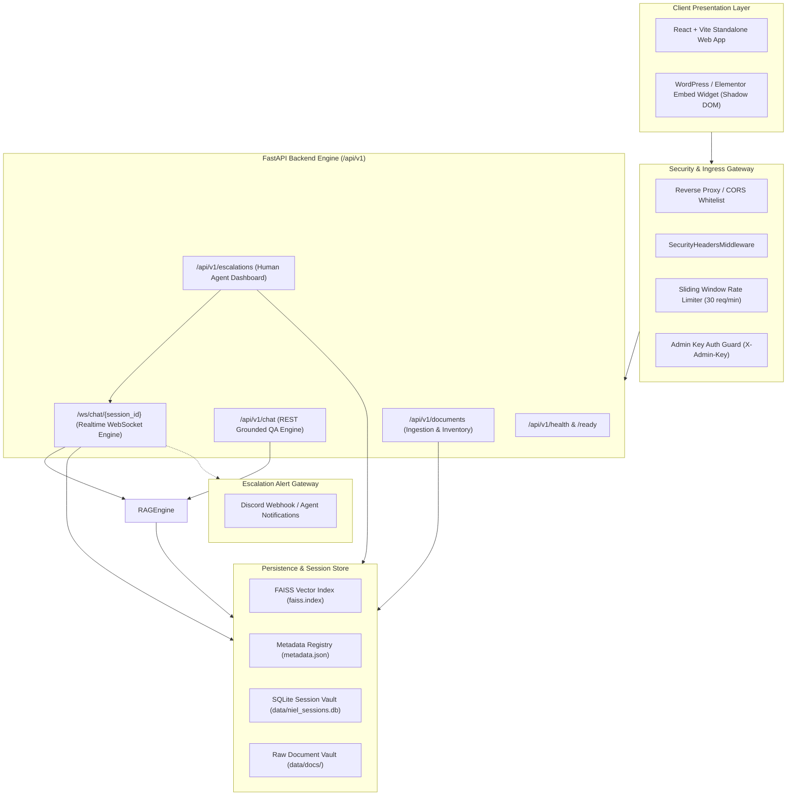

# NIEL Industrial Intelligence AI - System Architecture

## Key Technical Decisions:
1. **Shadow DOM Encapsulation**: Guarantees complete CSS and DOM isolation on third-party WordPress/Elementor pages.
2. **Deterministic SHA-256 Deduplication**: Eliminates duplicate vector embeddings, saving API spend.
3. **Negative Constraint Engineering**: Enforces strict abstention on unindexed pricing or commercial claims to prevent industrial hallucinations.
4. **Backend-Only Secret Isolation**: The client never receives or stores OpenAI keys or admin credentials.
5. **Realtime WebSocket Chat & Server-Side Session Memory**:
   - **Persistent SQLite Sessions**: Conversations are keyed by `session_id` and persisted in `data/niel_sessions.db` (zero-ops SQLite via SQLAlchemy 2.0).
   - **Server-Owned Context**: Conversation history is retrieved directly from SQLite (`max_turns=8`), eliminating reliance on client-sent history payloads.
   - **Single-Process WebSocket Manager (Known Limitation)**: An in-memory `ConnectionManager` routes active WebSockets within the running process. Scaling across multiple server worker processes will require an external pub/sub message bus (such as Redis Pub/Sub).
6. **Human Escalation & Agent Takeover**:
   - **Automatic & Manual Triggering**: Conversations containing phrases like "talk to a human" or manual button clicks trigger immediate escalation.
   - **AI Silence During Active Support**: When `human_active` is True, incoming visitor messages are persisted and pushed to human support without generating automated LLM responses.
   - **Pluggable Agent Alerts**: Dispatches incoming webhook notifications (e.g. Discord webhook) with session ID and contextual conversation summaries.
   - **Two-Way Agent Push**: Human agents reply via authenticated REST endpoints (`POST /api/v1/escalations/{session_id}/reply`), which instantly broadcasts messages into the visitor's open WebSocket.

