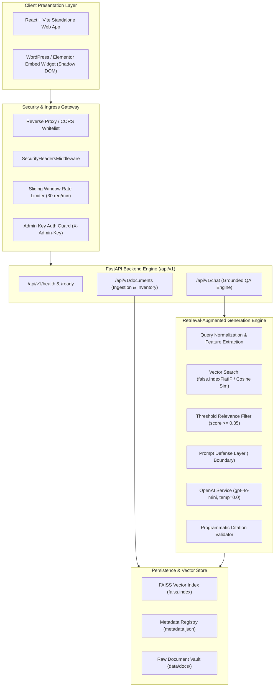

# NIEL Industrial Intelligence AI - System Architecture

## Key Technical Decisions:
1. **Shadow DOM Encapsulation**: Guarantees complete CSS and DOM isolation on third-party WordPress/Elementor pages.
2. **Deterministic SHA-256 Deduplication**: Eliminates duplicate vector embeddings, saving API spend.
3. **Negative Constraint Engineering**: Enforces strict abstention on unindexed pricing or commercial claims to prevent industrial hallucinations.
4. **Backend-Only Secret Isolation**: The client never receives or stores OpenAI keys or admin credentials.

